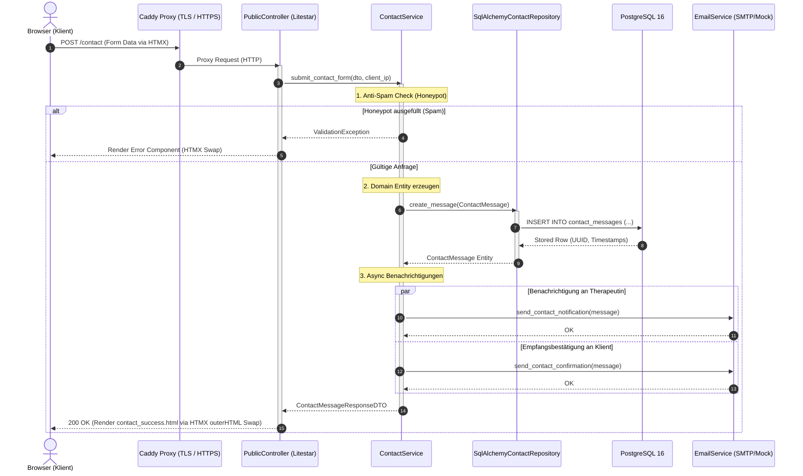

# ADR-0001: Tech-Stack und Architektur-Blueprint für Atemtherapie-Webapplikation

* **Status:** Accepted
* **Datum:** 2026-08-29
* **Autoren:** Development & Architecture Team
* **Kontext:** Single-Page Webapplikation für Atemtherapie-Praxis mit Admin-Interface

---

## 1. Kontext und Problemstellung

Für eine Atemtherapie-Praxis soll eine moderne, hochperformante und sichere Single-Page-Webapplikation entwickelt werden. Die Anwendung präsentiert das Profil der Therapeutin, ihre Methodenkompetenzen, Behandlungsangebote, Praxisinformationen und ermöglicht die Kontaktaufnahme / Terminanfrage. Ein integriertes Admin-Dashboard dient der Verwaltung von Inhalten und Anfragen.

Zentrale Anforderungen an das System:
1. **Strikte Clean Architecture mit OOP und Abstract Base Classes (ABCs)** für Entkopplung und Testbarkeit.
2. **Goldstandard-Tooling**: Moderne Python 3.12+ Toolchain (`uv`, `ruff`, `mypy`, `vulture`, `deptry`, `bandit`, `gitleaks`, `licensecheck`, `pytest`, `pre-commit`).
3. **Leichtgewichtiges Frontend**: Maximale Ladezeit-Geschwindigkeit, erstklassiges SEO für lokale Auffindbarkeit, geringer Wartungsaufwand (ohne Node.js Build-Overhead im Produktivbetrieb).
4. **Containerisierung & Deployment**: Lokale Docker-Entwicklungsumgebung und automatisiertes Deployment auf einem Cloud-Server mit Caddy Reverse Proxy (automatisches HTTPS).

---

## 2. Architekturentscheidung

Wir implementieren das Projekt basierend auf den folgenden Technologie- und Architektursäulen:

### 2.1 Technologie-Stack
- **Programmiersprache & Runtime:** Python 3.12+ mit `uv` als deterministischem Paketmanager (`pyproject.toml`).
- **Web-Framework:** `Litestar` (ASGI) – bietet erstklassige Unterstützung für Dependency Injection, OOP-Controller, native Integration von `Pydantic v2`, `Structlog` und OpenAPI.
- **Datenbank & ORM:** PostgreSQL 16 mit `SQLAlchemy 2.0 (Async)` und dem Treiber `asyncpg`. Migrationsmanagement via `Alembic`.
- **Frontend-Architektur:** Server-Driven Reactive UI mittels **Jinja2 + HTMX + Alpine.js + Tailwind CSS**.
- **Logging & Monitoring:** `structlog` (Farbige Konsole in Dev, strukturiertes JSON in Prod) + Health-Probes (`/health`, `/health/ready`).
- **Sicherheit & Hashing:** `Argon2id` via `argon2-cffi`, Session-Cookies, Honeypot Anti-Spam.
- **Webserver & Reverse Proxy:** `Granian` / `Uvicorn` als interner ASGI-Worker, `Caddy` mit HTTP/3 und automatischem TLS (Let's Encrypt) als Reverse Proxy.

---

## 3. Schichtenarchitektur (Clean Architecture & Ports/Adapters)

Die Codebasis folgt einer strikten 4-Schichten-Architektur:

```
┌─────────────────────────────────────────────────────────────┐
│ 1. Presentation Layer (Litestar Controllers, Jinja2, HTMX)  │
└──────────────────────────────┬──────────────────────────────┘
                               │ (ruft auf)
┌──────────────────────────────▼──────────────────────────────┐
│ 2. Application Layer (Services, DTOs, Use Cases)            │
└──────────────────────────────┬──────────────────────────────┘
                               │ (hängt ab von Ports / ABCs)
┌──────────────────────────────▼──────────────────────────────┐
│ 3. Domain Layer (Entities, Value Objects, ABC Interfaces)   │
└──────────────────────────────▲──────────────────────────────┘
                               │ (implementiert ABCs)
┌──────────────────────────────┴──────────────────────────────┐
│ 4. Infrastructure Layer (SQLAlchemy Repos, DB, SMTP, Config)│
└─────────────────────────────────────────────────────────────┘
```

---

## 4. Vollständiges UML-Klassendiagramm

```mermaid
classDiagram
    %% --- Domain Layer ---
    class BaseEntity {
        +UUID id
        +datetime created_at
        +datetime updated_at
    }

    class TherapistProfile {
        +str full_name
        +str title
        +str diploma
        +str tagline
        +str bio
        +str quote
        +str profile_image_url
        +str? booking_external_url
    }

    class ServiceOffering {
        +str title
        +str slug
        +str subtitle
        +str description
        +int duration_minutes
        +float price_chf
        +bool is_health_insurance_recognized
        +int sort_order
        +bool is_active
    }

    class Competency {
        +str title
        +str description
        +str icon_name
        +int sort_order
        +bool is_active
    }

    class ContactMessage {
        +str sender_name
        +str sender_email
        +str? sender_phone
        +str subject
        +str message
        +MessageStatus status
        +str? notes
    }

    BaseEntity <|-- TherapistProfile
    BaseEntity <|-- ServiceOffering
    BaseEntity <|-- Competency
    BaseEntity <|-- ContactMessage

    %% --- Domain Ports (ABCs) ---
    class IProfileRepository {
        <<interface>>
        +get_profile()* TherapistProfile
        +save_profile(profile)* TherapistProfile
        +get_competencies(active_only)* list~Competency~
        +get_services(active_only)* list~ServiceOffering~
        +get_service_by_id(service_id)* ServiceOffering?
        +save_service(service)* ServiceOffering
        +delete_service(service_id)* bool
        +get_practice_info()* PracticeInfo?
    }

    class IContactRepository {
        <<interface>>
        +create_message(message)* ContactMessage
        +get_messages(status, limit, offset)* list~ContactMessage~
        +get_message_by_id(message_id)* ContactMessage?
        +update_message(message)* ContactMessage
    }

    class IEmailService {
        <<interface>>
        +send_contact_notification(message)* bool
        +send_contact_confirmation(message)* bool
    }

    %% --- Infrastructure Adapters ---
    class SqlAlchemyProfileRepository {
        -AsyncSession session
        +get_profile() TherapistProfile
        +save_profile(profile) TherapistProfile
        +get_services() list~ServiceOffering~
    }

    class SqlAlchemyContactRepository {
        -AsyncSession session
        +create_message(message) ContactMessage
        +get_messages() list~ContactMessage~
    }

    class SmtpEmailService {
        -Settings settings
        +send_contact_notification(message) bool
        +send_contact_confirmation(message) bool
    }

    class MockEmailService {
        +send_contact_notification(message) bool
        +send_contact_confirmation(message) bool
    }

    IProfileRepository <|.. SqlAlchemyProfileRepository
    IContactRepository <|.. SqlAlchemyContactRepository
    IEmailService <|.. SmtpEmailService
    IEmailService <|.. MockEmailService

    %% --- Application Services ---
    class ProfileService {
        -IProfileRepository repo
        +get_public_profile() TherapistProfileDTO
        +update_profile(dto) TherapistProfileDTO
        +create_service(dto) ServiceOfferingDTO
    }

    class ContactService {
        -IContactRepository repo
        -IEmailService email_service
        +submit_contact_form(dto, client_ip) ContactMessageResponseDTO
        +list_messages(status) list~ContactMessageResponseDTO~
    }

    ProfileService --> IProfileRepository : uses
    ContactService --> IContactRepository : uses
    ContactService --> IEmailService : uses

    %% --- Presentation Controllers ---
    class PublicController {
        +index(profile_service) Template
        +handle_contact_form(contact_service, data) Template
        +impressum(profile_service) Template
        +datenschutz(profile_service) Template
    }

    class AdminController {
        +login_page() Template
        +process_login(auth_service, data) Response
        +dashboard(profile_service, contact_service) Template
    }

    PublicController --> ProfileService : DI
    PublicController --> ContactService : DI
    AdminController --> ContactService : DI
```



---

## 5. Sequenzdiagramm: HTMX-Kontaktformular & Benachrichtigung



---

## 6. Konsequenzen & Vorteile

### Positive Konsequenzen
1. **Hohe Entkopplung**: Die Geschäftslogik im `Domain`- und `Application`-Layer ist vollständig unabhängig vom Web-Framework (Litestar) und der Datenbank (PostgreSQL/SQLAlchemy).
2. **Robuste Testbarkeit**: Dank ABC-Interfaces können alle Services mit Mocks oder In-Memory-SQLite in Millisekunden getestet werden.
3. **Optimale Web-Performance & SEO**: Die Webseite rendert direkt serverseitig via Jinja2 mit minimalem JavaScript-Payload (HTMX + Alpine.js), was für mobile Nutzer und Suchmaschinen (Google) optimal ist.
4. **Sicherheit & Compliance**: Automatisiertes Secret-Scanning (`gitleaks`), Sicherheitsanalyse (`bandit`), strikte Typisierung (`mypy --strict`) und saubere Cookie-Sessions.
5. **Einfaches Deployment**: Der Server benötigt lediglich Docker Compose + Caddy.
