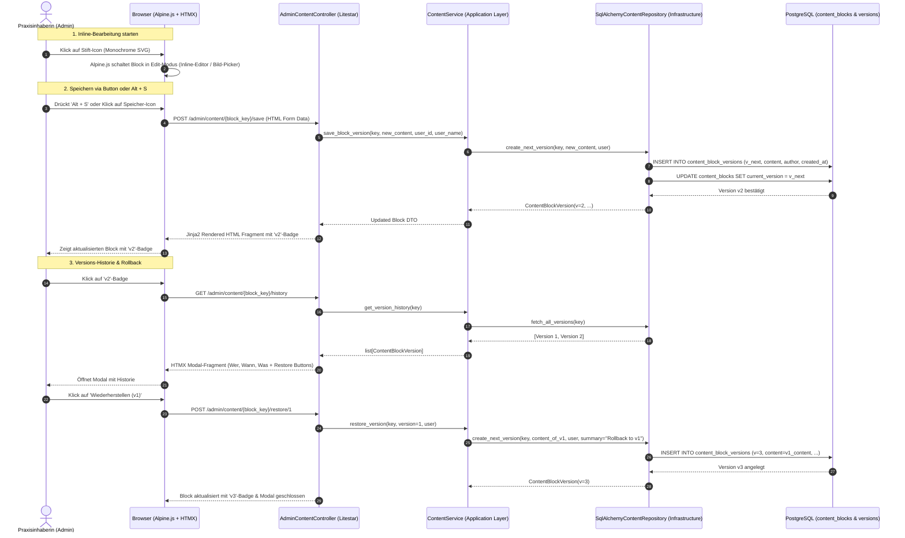

# ADR-0002: Live In-Context Inline-Editing und Append-Only Versionierungssystem

* **Status:** Accepted
* **Datum:** 2026-08-30
* **Autoren:** Development & Architecture Team
* **Kontext:** Administration & Redaktion von Website-Inhalten (Texte, Titel, Abschnitte, Bilder, Impressum) mit Live-Vorschau und Audit-Historie
* **Bezieht sich auf:** [ADR-0001: Tech-Stack und Architektur-Blueprint](ADR-0001-tech-stack-and-architecture-blueprint.md)

---

## 1. Kontext und Problemstellung

Die Inhalte der Single-Page Webapplikation (Titel, Fliesstexte, Abschnitte, Bilder, Praxishinweise, Impressum, Tarife etc.) müssen von der Praxisinhaberin flexibel, fehlerfrei und ohne Entwickler-Eingriff gepflegt werden können.

Klassische CMS-Formulare im Backend haben den Nachteil, dass der redaktionelle Inhalt losgelöst vom visuellen Erscheinungsbild (Typografie, Farbpaletten, Zeilenumbrüche, Bildverhältnisse) bearbeitet wird.

### 1.1 Kernanforderungen des Nutzers
1. **Live In-Context WYSIWYG:** Die Website behält zu 100% ihr originales Design. Authentifizierte Administratoren können Inhalte direkt im visuellen Kontext editieren.
2. **100% Universelle Editierbarkeit:**
   - **Texte & Titel:** Alle Überschriften (`h1`, `h2`, `h3`), Paragraphen (`p`), Zitate, Listen, Trust-Badges und Kontaktdaten.
   - **Kompetenzen & Angebote:** Alle Karten und Kassen-Infoboxen.
   - **Rechtliche Seiten:** Vollständiges Impressum und Datenschutzerklärung (DSG).
   - **Badges & Auszeichnungen:** OdA KT Diplom & Branchenzertifikat Badge auf dem Portrait.
   - **Bilder & Medien:** Therapeutinnen-Portrait, Praxis-Innenaufnahmen, Hero-Illustration via nicht-geclipptem Bild-Manager mit Upload-Funktion.
3. **Integrierter Medien-Manager & Dateiupload (`/static/images/`):**
   - **Direkter Datei-Upload:** Admin-Endpunkt `POST /admin/images/upload` (PNG, JPG, WEBP, SVG; max. 10 MB) speichert Bilddateien direkt in `src/atem/presentation/static/images/`.
   - **Visuelle Mediathek:** Endpunkt `GET /admin/images/list` listet alle vorhandenen Projektbilder mit Miniaturansichten zur 1-Klick-Auswahl auf.
   - **Non-Clipped Modal (`z-[100]`):** Das Bild-Auswahlfenster wird modal über der gesamten Seite geöffnet, damit organische oder runde Bilderrahmen (`overflow-hidden`) das Editor-Formular nicht abschneiden.
4. **Ergonomische Interaktion & Flaches Schwarz-Weiss-Icon-Design:**
   - **Icon-Design:** Ausschliesslich flache, schlichte monochrome Schwarz-Weiss-Vektorsymbole (Outline/Monochrome SVGs), keine farbigen Emojis.
   - **Starten:** Klick auf ein dezentes Stift-Vektor-Icon am jeweiligen Abschnitt/Titel/Bild/Textblock oder Doppelklick.
   - **Speichern:** Klick auf ein flaches Speicher-Icon (Diskette/Checkmark) oder Tastenkombination `Alt + S`.
   - **Abbrechen:** Drücken der `<Esc>`-Taste (verwirft ungespeicherte Änderungen sofort und stellt die Ansicht wieder her).
5. **Lückenlose Versionierung & Historie:**
   - Jede Speicherung erzeugt einen unveränderbaren Versionsdatensatz (Append-Only).
   - Nach dem Speichern wird am Block ein kleines Versions-Badge eingeblendet (z.B. `v1`, `v2`, `v3`).
   - Klick auf das Versions-Badge öffnet ein **modales Fenster** mit dem vollständigen Verlauf:
     - **Wer:** Benutzername des Bearbeiters.
     - **Zeit:** Datum & Uhrzeit der Änderung.
     - **Was:** Zusammenfassung / Vorher-Nachher-Inhalt der Änderung (mit Bildvorschau bei Bildblöcken).
6. **Sicheres Rollback (Wiederherstellung):**
   - Im Verlaufs-Modal kann jede frühere Version per Klick wiederhergestellt werden.
   - **Regel:** Die wiederhergestellte Version überschreibt nicht die Historie, sondern wird als **neue, nächsthöhere Version** angehängt (z.B. Wiederherstellen von `v1` bei aktuellem Stand `v3` erzeugt `v4` mit dem Inhalt von `v1`).

---

## 2. Architekturentscheidung

Wir implementieren ein **Server-Driven In-Context Inline Editing & Versioning Engine**, das sich nahtlos in die bestehende Clean Architecture und den Tech-Stack (`Litestar`, `SQLAlchemy 2.0 Async`, `HTMX`, `Alpine.js`, `Tailwind CSS`) einfügt.



---

## 3. Detaillierter Schichten-Entwurf

### 3.1 Domain Layer (`src/atem/domain/`)

#### Entitäten & Value Objects (`models/content.py`)
- `ContentBlockType`: Enum (`TEXT`, `TEXTAREA`, `RICH_TEXT`, `IMAGE_URL`, `PHONE`, `EMAIL`).
- `ContentBlock`:
  - `key: str` (z.B. `hero.title`, `hero.tagline`, `about.bio`, `about.image`, `practice.interior_image`, `practice.directions`).
  - `block_type: ContentBlockType`.
  - `section: str` (z.B. `hero`, `about`, `competencies`, `services`, `practice`, `impressum`).
  - `current_version_number: int`.
  - `current_content: str`.
  - `updated_at: datetime`.
- `ContentBlockVersion`:
  - `id: UUID`.
  - `block_key: str`.
  - `version_number: int` (1, 2, 3, ...).
  - `content: str`.
  - `author_id: UUID | None`.
  - `author_name: str`.
  - `change_summary: str | None`.
  - `created_at: datetime`.

#### Ports / Interface (`interfaces/content_repository.py`)
```python
class IContentRepository(ABC):
    @abstractmethod
    async def get_block(self, key: str) -> ContentBlock | None:
        """Fetch active content block by unique key."""

    @abstractmethod
    async def get_all_blocks(self) -> dict[str, ContentBlock]:
        """Fetch all content blocks as key-value lookup map."""

    @abstractmethod
    async def save_version(
        self,
        key: str,
        content: str,
        author_id: UUID | None,
        author_name: str,
        change_summary: str | None = None,
    ) -> ContentBlockVersion:
        """Append a new version for a content block and update active version."""

    @abstractmethod
    async def get_version_history(self, key: str) -> list[ContentBlockVersion]:
        """Fetch all versions ordered by version_number descending."""

    @abstractmethod
    async def restore_version(
        self,
        key: str,
        target_version_number: int,
        author_id: UUID | None,
        author_name: str,
    ) -> ContentBlockVersion:
        """Restore an older version by appending it as the next highest version."""
```

---

### 3.2 Application Layer (`src/atem/application/`)

- **DTOs (`dto/content.py`)**:
  - `SaveContentBlockRequestDTO`: Validierung von `key`, `content`, `change_summary`.
  - `ContentBlockResponseDTO`: Aktueller Text/Bild-Pfad, Typ, Versionsnummer, Badge-Label.
  - `ContentVersionHistoryDTO`: Liste aller Versionen mit formatierter Zeit, Autor, Vorschau und Differenz.
- **Service (`services/content_service.py`)**:
  - `get_content_map()`: Lädt alle Blöcke gecached/performant für das Jinja2 Template Rendering.
  - `save_block_content(...)`: Führt Validierung durch, verarbeitet Datei-Uploads bei Bildern, prüft auf reale Änderungen und persistiert `v+1`.
  - `restore_block_version(...)`: Lädt Zielversion und erzeugt neuen Snapshot mit `v_current + 1`.
  - `render_diff(old_text, new_text)`: Erzeugt lesbare Zusammenfassung für das Modal.

---

### 3.3 Infrastructure Layer (`src/atem/infrastructure/`)

#### Datenbank-Tabellen (SQLAlchemy Models)
1. **`content_blocks`**:
   - `key`: Primary Key (`VARCHAR(128)`).
   - `section`: `VARCHAR(64)` (für Filterung).
   - `block_type`: `VARCHAR(32)`.
   - `current_version_number`: `INTEGER NOT NULL DEFAULT 1`.
   - `current_content`: `TEXT NOT NULL`.
   - `updated_at`: `TIMESTAMPTZ NOT NULL`.
2. **`content_block_versions`**:
   - `id`: Primary Key (`UUID`).
   - `block_key`: Foreign Key auf `content_blocks.key` (`ON DELETE CASCADE`).
   - `version_number`: `INTEGER NOT NULL`.
   - `content`: `TEXT NOT NULL`.
   - `author_id`: `UUID NULL`.
   - `author_name`: `VARCHAR(128) NOT NULL`.
   - `change_summary`: `VARCHAR(255) NULL`.
   - `created_at`: `TIMESTAMPTZ NOT NULL`.
   - *Index*: `UNIQUE (block_key, version_number)`.

---

### 3.4 Presentation Layer (`src/atem/presentation/`)

#### Template Inline-Edit Jinja2 Macro (`components/editable_block.html`)
Unterstützt Text, Textarea und Bilder (`type='image'`) mit rein monochromen SVG-Icons:

```html

    
    
    

    
    <div
        x-data="inlineEditor('{{ key }}', '{{ type }}')"
        class="relative group/edit inline-block w-full"
        @keydown.window.escape="cancelEdit()"
    >
        <!-- View Mode -->
        <div x-show="!isEditing" class="relative">
            
                
            
                <{{ tag }} class="{{ class }}">
                    {{ val | safe if type == 'rich' else val }}
                </{{ tag }}>
            

            <!-- Admin Action Overlay Bar (Flache monochrome Vektor-Icons) -->
            <span class="inline-flex items-center gap-1.5 opacity-0 group-hover/edit:opacity-100 transition-opacity absolute -top-3 -right-3 z-30 bg-white border border-slate-300 shadow-sm px-2 py-0.5 rounded-full text-xs font-sans">
                <!-- Version Badge (Klick öffnet Modal) -->
                <button
                    type="button"
                    hx-get="/admin/content/{{ key }}/history"
                    hx-target="#version-history-modal-content"
                    @click="$dispatch('open-history-modal')"
                    class="px-1.5 py-0.5 rounded bg-slate-100 text-slate-800 font-bold text-[10px] hover:bg-slate-200 transition-colors"
                    title="Versionsverlauf ansehen"
                >
                    v{{ version }}
                </button>

                <!-- Edit Button (Schlichtes Schwarz-Weiss Stift-Icon) -->
                <button
                    type="button"
                    @click="startEdit()"
                    class="text-slate-700 hover:text-black p-0.5 focus:outline-none"
                    title="Bearbeiten"
                    aria-label="Bearbeiten"
                >
                    <svg class="w-3.5 h-3.5" width="14" height="14" fill="none" stroke="currentColor" viewBox="0 0 24 24">
                        <path stroke-linecap="round" stroke-linejoin="round" stroke-width="2" d="M15.232 5.232l3.536 3.536m-2.036-5.036a2.5 2.5 0 113.536 3.536L6.5 21.036H3v-3.572L16.732 3.732z"/>
                    </svg>
                </button>
            </span>
        </div>

        <!-- Inline Edit Mode -->
        <div x-show="isEditing" x-cloak class="relative mt-1">
            <form
                hx-post="/admin/content/{{ key }}/save"
                hx-swap="outerHTML"
                @keydown.alt.s.prevent="submitForm($el)"
            >
                
                <div class="space-y-2 p-3 bg-white rounded-2xl border-2 border-slate-800 shadow-lg font-sans">
                    <label class="block text-xs font-bold text-slate-700">Bild-URL oder lokaler Pfad:</label>
                    <input
                        type="text"
                        name="content"
                        x-ref="inputField"
                        value="{{ val }}"
                        class="w-full p-2 text-xs rounded border border-slate-300 focus:outline-none text-slate-900 bg-white"
                    />
                    <div class="flex gap-2 pt-1 items-center">
                        
                        <span class="text-[10px] text-slate-500">Vorschau</span>
                    </div>
                </div>
                
                <textarea
                    name="content"
                    x-ref="inputField"
                    rows="4"
                    class="w-full p-3 text-sm rounded-xl border-2 border-slate-800 bg-white text-slate-900 shadow-lg focus:outline-none"
                >{{ val }}</textarea>
                
                <input
                    type="text"
                    name="content"
                    x-ref="inputField"
                    value="{{ val }}"
                    class="w-full p-2 text-sm rounded-lg border-2 border-slate-800 bg-white text-slate-900 shadow-lg focus:outline-none"
                />
                

                <!-- Action Controls (Speichern mit monochrome Diskette-Icon, Alt+S, ESC) -->
                <div class="flex items-center justify-between mt-2 text-[11px] text-slate-600 font-sans">
                    <span class="flex items-center gap-2">
                        <kbd class="px-1.5 py-0.5 bg-slate-100 border border-slate-300 rounded text-[10px] text-slate-700">Alt + S</kbd> Speichern
                        <kbd class="px-1.5 py-0.5 bg-slate-100 border border-slate-300 rounded text-[10px] text-slate-700">Esc</kbd> Abbrechen
                    </span>
                    <div class="flex items-center gap-2">
                        <button
                            type="button"
                            @click="cancelEdit()"
                            class="px-2.5 py-1 rounded-md bg-slate-100 hover:bg-slate-200 text-slate-700 transition-colors"
                        >
                            Abbrechen
                        </button>
                        <button
                            type="submit"
                            class="px-3 py-1 rounded-md bg-slate-900 hover:bg-black text-white font-medium flex items-center gap-1.5 shadow-sm transition-colors"
                        >
                            <svg class="w-3.5 h-3.5" width="14" height="14" fill="none" stroke="currentColor" viewBox="0 0 24 24">
                                <path stroke-linecap="round" stroke-linejoin="round" stroke-width="2" d="M8 7H5a2 2 0 00-2 2v9a2 2 0 002 2h14a2 2 0 002-2V9a2 2 0 00-2-2h-3m-1 4l-3 3m0 0l-3-3m3 3V4"/>
                            </svg>
                            <span>Speichern</span>
                        </button>
                    </div>
                </div>
            </form>
        </div>
    </div>
    
        <!-- Standard Public View -->
        
            
        
            <{{ tag }} class="{{ class }}">
                {{ val | safe if type == 'rich' else val }}
            </{{ tag }}>
        
    

```

---

## 4. Modal für Versionshistorie & Wiederherstellung

Ein globales Alpine.js Modal (`#version-history-modal`) wird in `base.html` eingebunden:

```html
<div
    x-data="{ open: false }"
    x-show="open"
    @open-history-modal.window="open = true"
    @close-history-modal.window="open = false"
    @keydown.escape.window="open = false"
    class="fixed inset-0 z-50 flex items-center justify-center p-4 bg-slate-900/60 backdrop-blur-sm"
    x-cloak
>
    <div class="bg-white rounded-3xl border border-slate-200 shadow-2xl max-w-2xl w-full p-6 sm:p-8 space-y-6">
        <div class="flex justify-between items-center border-b border-slate-100 pb-4">
            <div>
                <span class="text-xs uppercase font-bold text-slate-400 tracking-wider">Audit Trail</span>
                <h3 class="text-xl font-bold text-slate-900">Versionsverlauf</h3>
            </div>
            <button @click="open = false" class="text-slate-400 hover:text-slate-700 text-lg font-bold">&times;</button>
        </div>

        <!-- Dynamisch per HTMX geladener Verlauf -->
        <div id="version-history-modal-content" class="space-y-4 max-h-[60vh] overflow-y-auto pr-2">
            <!-- Timeline mit: Version (vX), Wer, Zeitstempel, Inhalt & monochrome "Wiederherstellen"-Buttons -->
        </div>
    </div>
</div>
```

---

## 5. Konsequenzen

### Positive Konsequenzen
1. **Kein visueller Bruch:** Die Praxisinhaberin sieht exakt das Endresultat und muss nicht zwischen separaten Backend-Formularen und Frontend wechseln.
2. **Schlichtes monochromes Design:** Keine ablenkenden Farb-Emojis; einheitliche Schwarz-Weiss-Vektorsymbole.
3. **Vollständige Abdeckung:** Texte, Titel, Abschnitte und Bilder können direkt an Ort und Stelle bearbeitet werden.
4. **Maximale Ergonomie:** Schnelles Arbeiten durch Tastaturkürzel (`Alt + S` zum Speichern, `Esc` zum Abbrechen).
5. **Vollständige Revisionssicherheit:** Jeder Tastendruck/Save ist einem Benutzer, Zeitpunkt und Versionsstand zugeordnet.
6. **Sicheres Rollback ohne Datenverlust:** Da Wiederherstellungen stets eine neue Versionsnummer erzeugen (Append-Only), kann keine Historie versehentlich gelöscht werden.

### Negative Konsequenzen & Mitigationen
1. **Datenbank-Wachstum bei vielen Versionen:**
   - *Mitigation:* Blöcke speichern nur die Snapshot-Strings.
2. **Rechteverwaltung:**
   - *Mitigation:* Inline-Edit-Makros rendern die Editier-Widgets nur, wenn `request.session.get("user")` als authentifizierter Admin verifiziert ist. Öffentliche Besucher erhalten sauberen, schlanken HTML-Code ohne Editor-Logik.

---

## 6. Links & Referenzen
* [ADR-0001: Tech-Stack und Architektur-Blueprint](ADR-0001-tech-stack-and-architecture-blueprint.md)
* [UML-Klassendiagramm](../architecture/uml_class_diagram.md)
* [Sequenzdiagramme](../architecture/sequence_diagrams.md)
* [Playbook: GEMINI.md](../../GEMINI.md)
