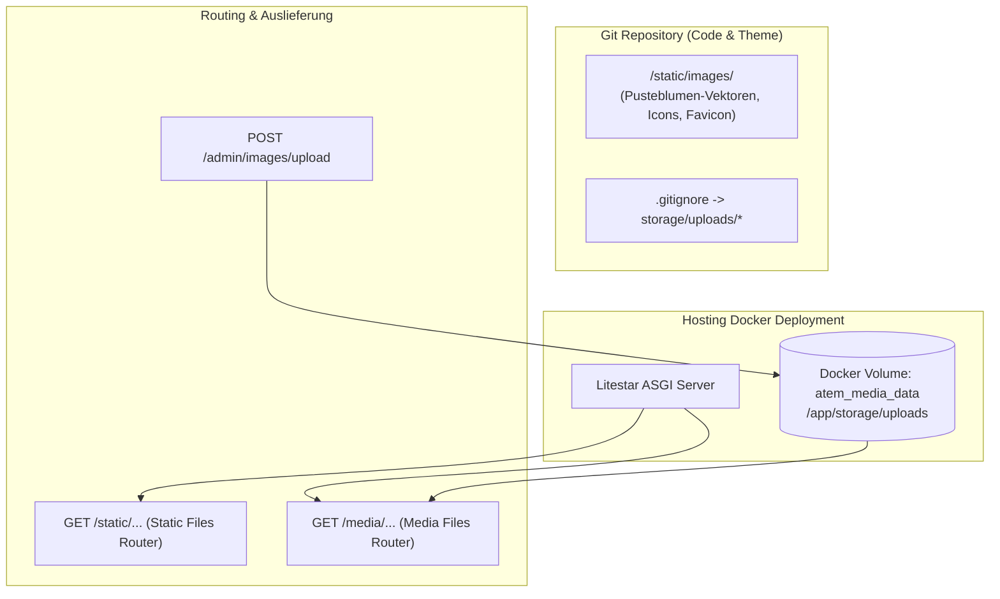

# ADR-0003: Persistenter Medienspeicher und Produktions-Persistenz

* **Status:** Accepted
* **Datum:** 2026-08-30
* **Autoren:** Development & Architecture Team
* **Kontext:** Trennung von statischen Code-Assets und dynamischen Benutzer-Medien (Portraits, Bilder) zur Vermeidung von Git-Verschmutzung und Datenverlust bei Container-Rebuilds.
* **Bezieht sich auf:** [ADR-0001: Tech-Stack und Architektur-Blueprint](ADR-0001-tech-stack-and-architecture-blueprint.md), [ADR-0002: Live Inline-Editing & Versionierung](ADR-0002-live-inline-content-editing-and-versioning-system.md)

---

## 1. Kontext und Problemstellung

In der bisherigen Implementierung wurden über das Admin-Interface hochgeladene Bilddateien (z. B. Therapeutinnen-Portrait, Praxisaufnahmen) direkt in das statische Quellcodeverzeichnis `src/atem/presentation/static/images/` geschrieben.

Dies führte zu zwei gravierenden Problemen:
1. **Lokale Git-Verschmutzung:** Jeder Upload erzeugte neue unversionierte Git-Dateien (`git status: untracked files`), die bei Commits manuell bereinigt werden mussten und das Risiko bargen, binäre Uploads versehentlich in das Git-Repository zu committen.
2. **Datenverlust in Produktion (Hosting / Docker):** In einer containerisierten Umgebung (Docker) wird der Container bei einem Release / Deployment (`docker compose up -d --build`) neu gebaut. Da die Uploads im flüchtigen Container-Dateisystem lagen, gingen alle in Produktion hochgeladenen Bilder bei jedem Update unwiderruflich verloren.

---

## 2. Betrachtete Optionen

* **Option A (Ausgewählt): Dediziertes Medien-Verzeichnis `storage/uploads/` mit persistiertem Docker-Volume `atem_media_data` & `.gitignore`**
  - Saubere architektonische Trennung zwischen `/static/` (Code-Assets im Git-Repo) und `/media/` (dynamische Uploads im persistenten Volume).
  - Maximale Performance und Caching.
  - Vollständige Git-Sauberkeit.
* **Option B: Speicherung von Bildern als BLOB (`BYTEA`) in PostgreSQL**
  - Keine Dateisystem-Abhängigkeit, aber deutliche Vergrösserung der Datenbank-Backups und erhöhte Latenz beim Ausliefern von Bilddaten über Python/DB.
* **Option C: Cloud Object Storage (S3 / Cloudflare R2 / SFTP-Backup-Speicher)**
  - Gute Skalierbarkeit, aber unnötige externe Cloud-Abhängigkeit und Kosten für eine eigenständige Praxis-Webseite auf einem Server.

---

## 3. Architekturentscheidung

Wir implementieren **Option A**:

### 3.1 Komponenten & Details
1. **Konfiguration (`Settings`):**
   - Neues Setting `MEDIA_DIR: str = "storage/uploads"` mit Pfadauflösung `media_storage_path: Path`.
2. **Git-Ignorierung:**
   - In `.gitignore` wird `storage/uploads/*` ignoriert (mit Ausnahme von `!storage/uploads/.gitkeep`).
3. **Litestar Media Routing:**
   - Registrierung eines dedizierten `create_static_files_router(path="/media", directories=[settings.media_storage_path], name="media")`.
4. **Admin Upload & Mediathek:**
   - `POST /admin/images/upload` speichert Uploads in `storage/uploads/` und liefert `/media/{filename}` zurück.
   - `GET /admin/images/list` listet sowohl dynamische Medien (`/media/...`) als auch gebündelte Theme-Illustrationen (`/static/images/...`) auf.
5. **Docker Volume Persistenz:**
   - In `docker-compose.prod.yml` wird das benannte Volume `atem_media_data:/app/storage/uploads` gemountet.

---

## 4. Konsequenzen

### Positive Konsequenzen:
* ✅ **Zero Git Dirtiness:** Bild-Uploads hinterlassen zu keinem Zeitpunkt uncommitted Git-Dateien.
* ✅ **Dauerhafte Persistenz:** Deployments und Container-Rebuilds zerstören keine hochgeladenen Bilder.
* ✅ **Schlanke Datenbank:** PostgreSQL speichert nur Metadaten und URLs, keine grossen Binär-BLOBs.
* ✅ **Standardkonformität:** Folgt dem etablierten Best-Practice-Muster moderner Web-Frameworks.

### Zu beachtende Punkte:
* Server-Backups müssen neben dem PostgreSQL-Dump auch das Docker-Volume `atem_media_data` sichern.
