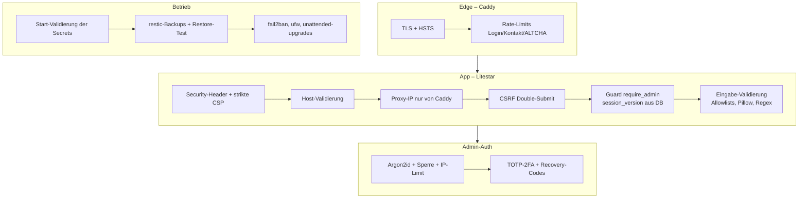

# ADR-0004: Security-Architektur (Bootstrap, Admin-Auth, Eingaben, CSP, Betrieb)

* **Status:** accepted
* **Deciders:** Nicolas Mischler
* **Date:** 2026-10-04
* **Technical Story:** Go-Live-Härtung nach interner Code-Analyse (lokaler Bericht, nicht versioniert)

## Context and Problem Statement

Vor dem Go-Live von `www.pusterum.be` zeigte eine Analyse u. a.: Produktion lief faktisch im
Entwicklungsmodus (Schema nur via `create_all` in dev), öffentliche Default-Secrets, kein CSRF-Schutz,
kein Brute-Force-Schutz, gespeicherte XSS über Theme-Werte und SVG-Uploads, Kontaktformular als
Spam-Relay, keine CSP, keine Backups. Gesucht war ein kohärentes Sicherheitsmodell für eine kleine
Praxis-Website mit genau einer administrierenden Person – maximal sicher, aber ohne Drittanbieter-Abhängigkeiten
und ohne Betriebsaufwand.

## Decision Drivers

* Schutz der Besucher (keine gespeicherte XSS, keine Datenabflüsse an Dritte – DSG/DSGVO)
* Übernahme des Admin-Kontos muss praktisch ausgeschlossen sein (auch bei Passwort-Leak)
* Missbrauch durch Bots (Spam, Brute-Force) ohne externe Dienste abwehren
* Sicherheit durch Defaults: Fehlkonfiguration darf nicht unbemerkt in Produktion gehen
* Einfacher Betrieb auf einem einzelnen Cloud-Server mit Docker Compose

## Considered Options

* A: Bestehende App punktuell patchen
* B: Mehrschichtiges Modell (Defense in Depth) über alle Schichten inkl. Infrastruktur
* C: Admin-Bereich hinter VPN/IP-Allowlist auslagern

## Decision Outcome

Gewählt: **B – Defense in Depth**, weil nur so jede einzelne Schwachstelle durch mindestens eine
weitere Schicht abgefangen wird. C wurde verworfen (Praxisinhaberin arbeitet mobil, wechselnde IPs).

### Kernelemente

| Bereich | Entscheidung |
| :--- | :--- |
| Bootstrap | Alembic-Baseline besitzt das Schema; Entrypoint migriert (Advisory-Lock) und seedet; erster Admin per CLI. `ENVIRONMENT` default `production`; Start verweigert bei Dev-Secret, `DEBUG`, Platzhaltern, Mail ohne TLS. |
| Sessions | Verschlüsseltes Cookie (Schlüssel per HKDF), `Secure`/`HttpOnly`/`SameSite=Strict`, 12 h; serverseitiger Widerruf über `User.session_version`; Logout per POST. |
| Admin-Login | Argon2id, Dummy-Hash gegen Enumeration, Sperre mit exponentiellem Back-off, DB-basiertes IP-Limit, TOTP-2FA (Pflicht in Produktion) mit Replay-Schutz und 10 Recovery-Codes; TOTP-Secret Fernet-verschlüsselt. |
| Autorisierung | Controller-Guard `require_admin`; Regressionstest entdeckt alle `/admin`-Routen automatisch. |
| CSRF | Litestar `CSRFConfig`; HTMX/`fetch` per Header, Formulare per Hidden-Feld. |
| Eingaben | Theme: Hex-Regex + Font-Allowlist + Re-Validierung beim Rendern; Content: nur existierende Keys, Bildpfad-Muster, Längenlimit, Tag-/Klassen-Allowlist, `\|tojson`; Uploads: Pillow-Verifikation + Re-Encoding, kein SVG, Zufallsnamen. |
| Kontaktformular | ALTCHA (self-hosted), Zeit-Token, Honeypot, IP-Limits, Bestätigungsmail ohne Besuchertext (max. 1×/Tag/Adresse), Aufbewahrungsfrist. |
| Browser | Strikte CSP ohne `unsafe-inline`/`unsafe-eval` für Skripte; Tailwind kompiliert, Alpine-CSP-Build, lokale Fonts; COOP/CORP, `nosniff`, Frame-Verbot; `/media` mit Sandbox-CSP. |
| Infrastruktur | Gepinnte Images, `no-new-privileges`, `cap_drop`, Read-only-Root-FS, Limits, Log-Rotation, Trivy-Scan in CI; Backups per restic; cloud-init-Härtung; fail2ban auf `login_failed`. |

### Positive Consequences

* Jede Schwachstelle der Analyse ist geschlossen und durch Tests abgesichert (Unit, HTTP, Playwright-E2E mit CSP-Prüfung).
* Keine Drittanbieter im Browser (keine Cookies/Tracking, DSG-konform).
* Fehlkonfiguration in Produktion führt zu einem sofortigen, verständlichen Startabbruch.

### Negative Consequences

* Alpine-CSP-Build: keine Inline-Ausdrücke mit Template-Literals/Globals – Logik gehört in Komponenten.
* 2FA erfordert eine Authenticator-App; Notfallweg über Recovery-Codes bzw. `atem.cli reset-2fa`.
* CSS muss gebaut werden (`scripts/build-css.sh`), im Docker-Build automatisch.

## Links

* [TDR-0004 ALTCHA](../tdr/TDR-0004-altcha-captcha.md) · [TDR-0005 Strikte CSP](../tdr/TDR-0005-tailwind-build-and-strict-csp.md) · [TDR-0006 Backups](../tdr/TDR-0006-restic-backups.md)
* [Runbook](../ops/runbook.md)
