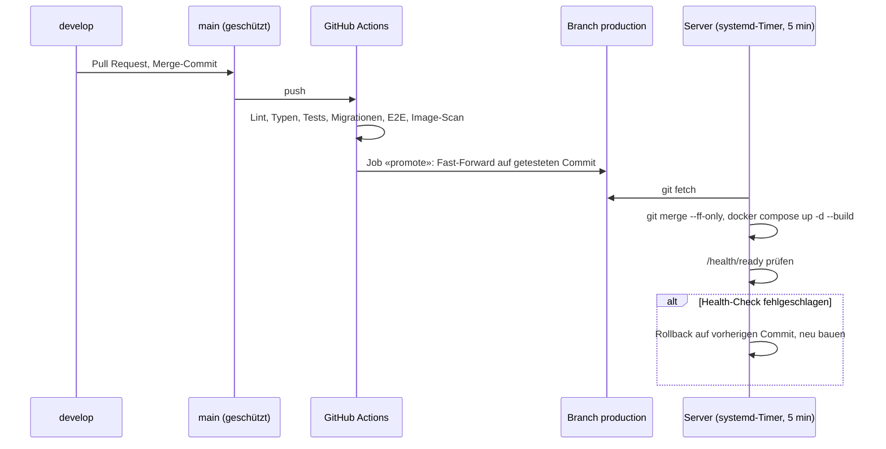

# ADR-0005: Automatisches Deployment per Pull-Prinzip (Branch `production`)

* **Status:** accepted
* **Deciders:** Nicolas Mischler
* **Date:** 2026-10-13
* **Technical Story:** Deployments liefen manuell per SSH (`git pull` + `docker compose up -d --build`).
  Ziel: Jeder Merge nach `main` geht nach grüner CI automatisch live.

## Context and Problem Statement

`main` ist geschützt (Pull Request + sechs Pflicht-Checks, nur Merge-Commits). Der Produktionsserver
ist ein einzelner Cloud-Server mit Docker Compose; SSH ist per Firewall auf die Adresse der
administrierenden Person beschränkt und per fail2ban abgesichert. Wie kommt ein getesteter Stand
automatisch auf den Server, ohne diese Härtung aufzuweichen?

## Decision Drivers

* Nur Stände deployen, deren CI vollständig grün ist
* Keine eingehenden Verbindungen und keine Server-Zugangsdaten in GitHub (Repo ist öffentlich)
* Fehlgeschlagene Deployments dürfen die Website nicht offline lassen
* Einfach nachvollziehbar und ohne zusätzliche Dienste betreibbar

## Considered Options

* A: Push-Deployment – GitHub Actions verbindet sich per SSH mit dem Server
* B: Self-hosted GitHub Runner auf dem Server
* C: Pull-Deployment – CI markiert den getesteten Stand, der Server holt ihn selbst ab
* D: Container-Registry + Image-Updater (z. B. Watchtower)

## Decision Outcome

Chosen option: «C: Pull-Deployment», weil es als einzige Option ohne eingehende Verbindung und ohne
Secrets in GitHub auskommt und die bestehende Server-Härtung unverändert lässt.

Ablauf:

* **CI** (`.github/workflows/ci.yml`, Job `promote`): läuft nur bei `push` auf `main` und erst, wenn
  alle anderen Jobs grün sind; verschiebt `production` ausschliesslich per Fast-Forward.
  Bleibt das Push-Ereignis eines Merges nach `main` bei GitHub aus (so geschehen beim Release
  1.4.0), startet `gh workflow run ci.yml --ref main` denselben Lauf von Hand (`workflow_dispatch`,
  nur auf `main`). Die Pflicht-Checks laufen dabei vollständig mit.
* **Server** (`ops/deploy/pusterum-deploy.sh`, `pusterum-deploy.service`/`.timer`): prüft alle
  5 Minuten auf einen neuen Commit, verweigert Deployments bei lokalen Änderungen oder ohne
  Fast-Forward, baut neu, prüft `/health/ready` (bis 5 Minuten) und rollt bei Fehler zurück.
  Ein fehlgeschlagener Commit wird nicht erneut versucht, bis ein neuer kommt. `flock` verhindert
  parallele Läufe; Ausgaben landen im systemd-Journal.
* **Benachrichtigung** (Nachtrag 2026-10-14): Jeder Lauf prüft auch ohne neuen Commit die
  Live-Website und meldet das Ergebnis per Ping an einen Healthcheck-Dienst (`DEPLOY_PING_URL` in
  `deploy.env`, Vorlage `config/deploy.env.production.example`): `<url>` = ok, `<url>/fail` mit der
  Meldung. Der Dienst alarmiert per Mail bei `/fail` und wenn Pings ausbleiben (Server oder Timer
  ausgefallen). Ein fehlgeschlagener Commit hält den Alarm, bis ein neuer Commit gesund läuft.
* **Manuell** bleibt möglich (Runbook Abschnitt 2), z. B. bei pausiertem Timer.

### Positive Consequences

* Kein SSH-Zugang, kein Deploy-Secret und keine Firewall-Ausnahme für GitHub
* `production` zeigt jederzeit den zuletzt freigegebenen, vollständig getesteten Stand
* Automatischer Rollback hält die Website bei fehlerhaften Releases online

### Negative Consequences

* Bis zu ~5 Minuten Verzögerung zwischen grüner CI und Live-Stand
* Das Image wird auf dem Server gebaut (wie bisher) – kurze Lastspitze, kurzer Unterbruch beim
  Container-Wechsel
* Rollback setzt nur den Code zurück: Migrationen müssen additiv bleiben (bestehende Regel, TDR-0003);
  bei Schema-Problemen hilft nur das Backup (Runbook 3.3)
* Benachrichtigung hängt von einem externen Healthcheck-Dienst ab (ohne `DEPLOY_PING_URL` nur Journal)

## Pros and Cons of the Options

### A: Push-Deployment per SSH

* Good, because sofortiges Deployment und Logs direkt in GitHub
* Bad, because SSH müsste für wechselnde GitHub-IP-Adressen geöffnet und ein privater Schlüssel als
  Secret in einem öffentlichen Repo hinterlegt werden

### B: Self-hosted Runner

* Good, because volle CI-Integration
* Bad, because GitHub rät bei öffentlichen Repos ausdrücklich davon ab: fremde Pull Requests könnten
  Code auf dem Produktionsserver ausführen

### C: Pull-Deployment

* Good, because keine eingehende Verbindung, keine Secrets, einfache Shell + systemd
* Bad, because Polling-Verzögerung; Fehler ohne Zusatzdienst nur im Server-Journal sichtbar

### D: Registry + Image-Updater

* Good, because Images werden einmal in der CI gebaut
* Bad, because zusätzliche Registry, Zugangsdaten und ein weiterer Dienst; Migrationen und
  Health-Check/Rollback müssten trotzdem eigens gelöst werden

## Links

* Betrieb, Installation und Notfälle: `docs/ops/runbook.md` (Abschnitte 1.13 und 2, verschlüsselt)
* [ADR-0004](ADR-0004-security-architecture.md) – Security-Architektur
* [TDR-0003](../tdr/TDR-0003-quote-rotator-and-content-migrations.md) – additive Datenmigrationen
