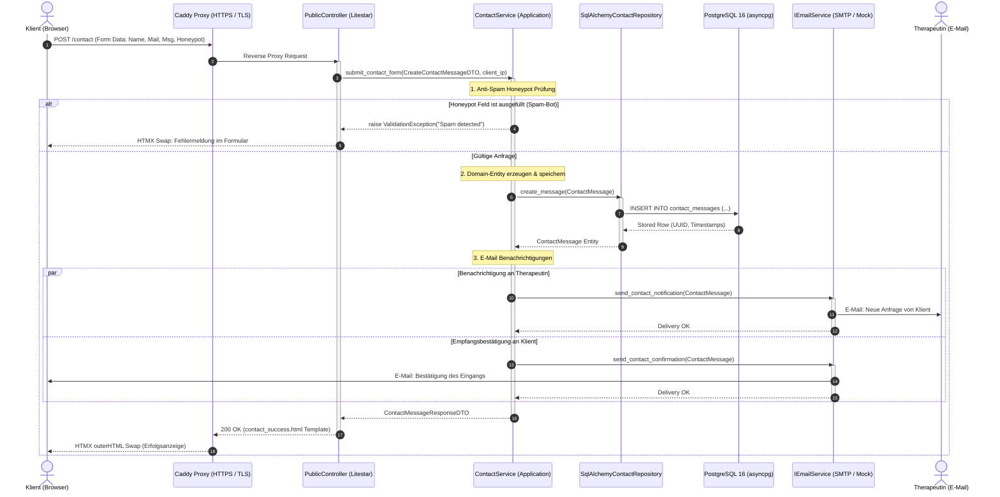
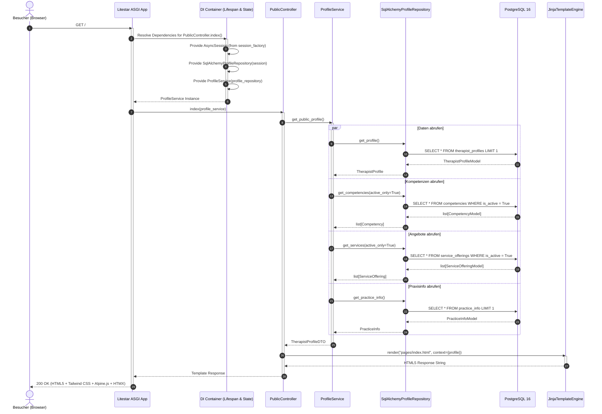
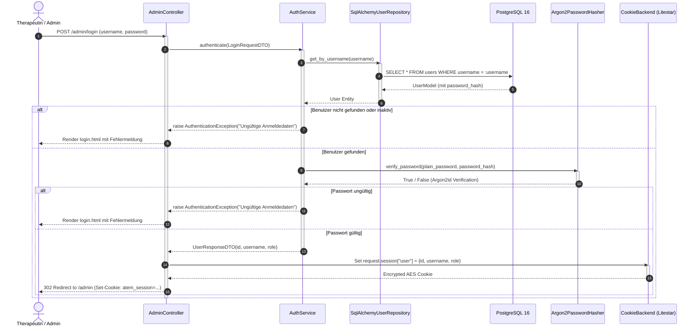
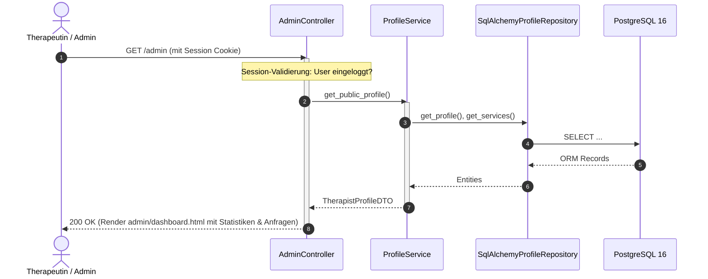
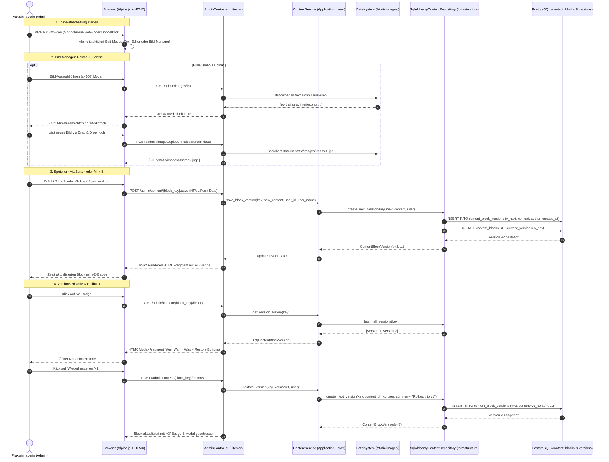

# Sequenzdiagramme: Atemtherapie Webapplikation

> **Übersicht:** Detaillierte Sequenzabläufe für alle Kernprozesse der Webapplikation (Klienten-Interaktion, HTMX-Events, E-Mail-Dispatching, Authentifizierung und Inhaltsverwaltung).

---

## 1. HTMX Kontaktformular & Benachrichtigungs-Workflow

Visualisiert das Absenden einer Terminanfrage über das HTMX-Frontend mit Anti-Spam-Prüfung, Datenbankpersistierung und asynchronem Mail-Versand.

---

## 2. Public Page Rendering & Dependency Injection Flow

Visualisiert das Laden der Landing-Page (`GET /`) mit Dependency Injection der Repositories und Services.

---

## 3. Administrator-Authentifizierung & Session Flow

Visualisiert die Anmeldung im Admin-Bereich mit Argon2id Passwort-Prüfung und verschlüsselten Cookies.

---

## 4. Inhaltsverwaltung & Angebots-CRUD (Admin)

Visualisiert die Verwaltung von Behandlungsangeboten und Profilinhalten.

---

## 5. Live In-Context Inline-Editing & Versioning Workflow (ADR-0002)

* **PlantUML-Spezifikation:** [`inline_edit_versioning_sequence.puml`](inline_edit_versioning_sequence.puml)
* **Mermaid-Datei:** [`inline_edit_versioning_sequence.mmd`](inline_edit_versioning_sequence.mmd)

Visualisiert den vollständigen Redaktionsprozess direkt im Live-Layout der Website inklusive Tastatursteuerung (<kbd>Alt</kbd> + <kbd>S</kbd>, <kbd>Esc</kbd>), flachen monochromen Icons, Append-Only Versionierung und sicherem Rollback.

