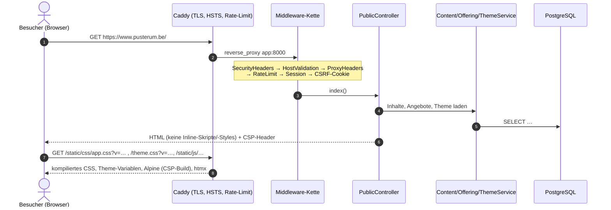
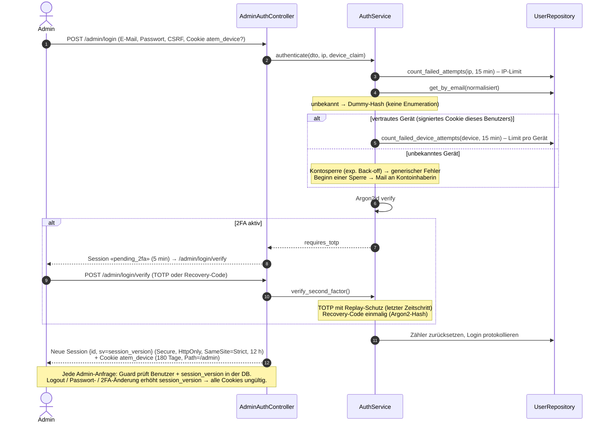
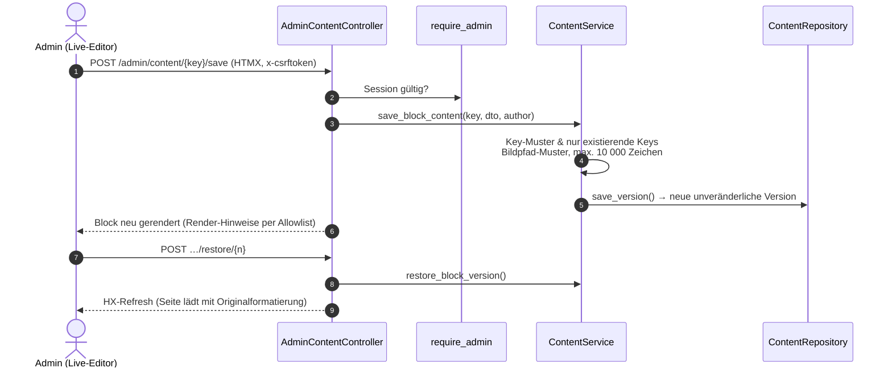
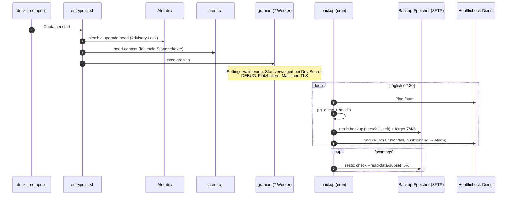
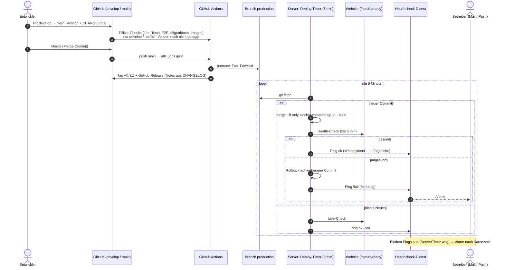

# Sequenzdiagramme – PUSTERUM

> Stand 2026-10-15 (v1.1). Mermaid ist die einzige Quelle.

---

## 1. Seitenaufruf (strikte CSP, Theme als Stylesheet)



---

## 2. Kontaktformular (ALTCHA, Limits, sichere Mails)

```mermaid
sequenceDiagram
    autonumber
    actor B as Besucher
    participant P as PublicController
    participant CS as ContactService
    participant CAP as AltchaCaptcha
    participant R as ContactRepository
    participant MAIL as SmtpEmailService
    actor T as Praxis (E-Mail)

    B->>P: GET /altcha/challenge
    P->>CAP: create_challenge() (HMAC-signiert, Ablauf 20 min)
    alt Challenge nicht ladbar (z. B. Firmen-Proxy, 403)
        P-->>B: Hinweis «Sicherheitsprüfung nicht geladen» + mailto-Link der Praxis
    end
    P-->>B: Challenge → Web-Worker löst Proof-of-Work
    B->>P: POST /contact (HTMX, CSRF-Header, form_token, altcha)
    P->>P: Zeit-Token prüfen (≥ 3 s, ≤ 2 h)
    P->>CS: submit_contact_form(dto, ip, payload)
    CS->>CS: Honeypot leer?
    CS->>CAP: verify(payload)
    CS->>R: register_captcha_challenge(id) – Replay-Schutz
    CS->>R: count_messages_from_ip(1 h / 24 h)
    alt Limit überschritten
        CS-->>P: RateLimitedException
        P-->>B: Formular-Karte mit Hinweis
    else ok
        CS->>R: create_message(…, email_hash)
        CS->>MAIL: send_contact_notification (Vorname, Betreff, Admin-Link; kein Text)
        MAIL-->>T: Neue Anfrage
        CS->>R: confirmation_sent_since(email_hash, 24 h)?
        CS->>MAIL: send_contact_confirmation(Adresse) – fester Text, max. 1×/Tag
        P-->>B: Erfolgs-Karte (nur dieses Partial wird getauscht)
    end
```

---

## 3. Admin-Login mit Zwei-Faktor-Anmeldung



---

## 4. Inline-Bearbeitung & Versionierung (ADR-0002)



---

## 5. Produktionsstart & Backups



---

## 6. Release & automatisches Deployment mit Alarmierung (ADR-0005, TDR-0009)


