# UML-Klassendiagramm – PUSTERUM

> Stand 2026-10-04 (nach Go-Live-Härtung). Einzige Quelle für das Diagramm ist diese Datei (Mermaid).
> Abhängigkeiten zeigen ausschliesslich nach innen: Presentation → Application → Domain ← Infrastructure.

```mermaid
classDiagram
    direction LR

    %% ================= DOMAIN =================
    namespace Domain {
        class BaseEntity {
            +UUID id
            +datetime created_at
            +datetime updated_at
        }
        class User {
            +str email
            +str password_hash
            +UserRole role
            +bool totp_enabled
            +int session_version
            +int failed_login_count
            +datetime locked_until
            +is_locked(now) bool
            +register_failed_login(now)
            +register_successful_login(now)
            +revoke_sessions()
        }
        class ContactMessage {
            +str sender_name
            +str sender_email
            +str subject
            +str message
            +MessageStatus status
            +str ip_address
            +str email_hash
            +bool confirmation_sent
        }
        class ContentBlock {
            +str key
            +ContentBlockType block_type
            +int current_version_number
            +str current_content
        }
        class ContentBlockVersion {
            +str block_key
            +int version_number
            +str content
            +str author_name
        }
        class ServiceOffering {
            +str title
            +str slug
            +int duration_minutes
            +float price_chf
            +bool is_active
        }
        class ThemeConfig {
            +ColorPresetKey preset_key
            +str primary_color
            +str heading_font
            +ShapeType active_shape
            +list~DandelionEffectMode~ dandelion_modes
            +apply_palette(preset_key)
        }
        class IUserRepository
        class IContactRepository
        class IContentRepository
        class IOfferingRepository
        class IThemeRepository
        class IEmailService
        class IPasswordHasher
        class ISecretCipher
        class ITotpProvider
        class ICaptcha
        class IImageSanitizer
    }

    BaseEntity <|-- User
    BaseEntity <|-- ContactMessage
    BaseEntity <|-- ContentBlock
    BaseEntity <|-- ContentBlockVersion
    BaseEntity <|-- ServiceOffering
    BaseEntity <|-- ThemeConfig

    %% ================= APPLICATION =================
    namespace Application {
        class AuthService {
            +authenticate(dto, ip) LoginResultDTO
            +verify_second_factor(user_id, code, ip)
            +confirm_totp_setup(user_id, secret, code) list
            +change_password(user_id, current, new)
            +logout(user_id)
            +get_session_user(user_id, version)
        }
        class ContactService {
            +create_captcha_challenge() dict
            +submit_contact_form(dto, ip, captcha)
            +update_message_status(id, status)
            +delete_message(id)
            +purge_expired(retention)
        }
        class ContentService {
            +seed_defaults() int
            +get_content_map()
            +save_block_content(key, dto, author)
            +restore_block_version(key, version, author)
        }
        class OfferingService {
            +list_services(include_inactive)
            +create_service(form)
            +update_service(id, form)
            +delete_service(id)
        }
        class ThemeService {
            +set_preset(key)
            +set_shape(shape)
            +apply_dandelion_modes(modes, size, opacity)
            +update_theme(dto)
            +generate_css_variables(theme) str
        }
        class MediaService {
            +store_upload(raw) MediaItem
            +list_images() list
        }
    }

    AuthService --> IUserRepository
    AuthService --> IPasswordHasher
    AuthService --> ISecretCipher
    AuthService --> ITotpProvider
    ContactService --> IContactRepository
    ContactService --> IEmailService
    ContactService --> ICaptcha
    ContentService --> IContentRepository
    OfferingService --> IOfferingRepository
    ThemeService --> IThemeRepository
    MediaService --> IImageSanitizer

    %% ================= INFRASTRUCTURE =================
    namespace Infrastructure {
        class SqlAlchemyRepository~ModelT, EntityT~ {
            #_get(id)
            #_add(entity)
            #_save(entity)
            #_delete(id)
            #_list(where, order_by)
        }
        class SqlAlchemyUserRepository
        class SqlAlchemyContactRepository
        class SqlAlchemyOfferingRepository
        class SqlAlchemyThemeRepository
        class SqlAlchemyContentRepository
        class SmtpEmailService
        class Argon2PasswordHasher
        class FernetSecretCipher
        class PyotpTotpProvider
        class AltchaCaptcha
        class PillowImageSanitizer
    }

    SqlAlchemyRepository <|-- SqlAlchemyUserRepository
    SqlAlchemyRepository <|-- SqlAlchemyContactRepository
    SqlAlchemyRepository <|-- SqlAlchemyOfferingRepository
    SqlAlchemyRepository <|-- SqlAlchemyThemeRepository
    IUserRepository <|.. SqlAlchemyUserRepository
    IContactRepository <|.. SqlAlchemyContactRepository
    IOfferingRepository <|.. SqlAlchemyOfferingRepository
    IThemeRepository <|.. SqlAlchemyThemeRepository
    IContentRepository <|.. SqlAlchemyContentRepository
    IEmailService <|.. SmtpEmailService
    IPasswordHasher <|.. Argon2PasswordHasher
    ISecretCipher <|.. FernetSecretCipher
    ITotpProvider <|.. PyotpTotpProvider
    ICaptcha <|.. AltchaCaptcha
    IImageSanitizer <|.. PillowImageSanitizer

    %% ================= PRESENTATION =================
    namespace Presentation {
        class PublicController
        class HealthController
        class AdminAuthController
        class AdminSecurityController
        class AdminDashboardController
        class AdminDesignController
        class AdminContentController
        class AdminMediaController
        class AdminServicesController
        class require_admin {
            <<guard>>
        }
        class SecurityHeadersMiddleware
        class HostValidationMiddleware
        class ProxyHeadersMiddleware
    }

    PublicController --> ContactService
    PublicController --> ContentService
    PublicController --> OfferingService
    AdminAuthController --> AuthService
    AdminSecurityController --> AuthService
    AdminDashboardController --> ContactService
    AdminDesignController --> ThemeService
    AdminContentController --> ContentService
    AdminMediaController --> MediaService
    AdminServicesController --> OfferingService
    AdminDashboardController ..> require_admin
    AdminDesignController ..> require_admin
    AdminContentController ..> require_admin
    AdminMediaController ..> require_admin
    AdminServicesController ..> require_admin
    AdminSecurityController ..> require_admin
```

## Erläuterungen

* **Domain** enthält Entitäten mit Verhalten (Sperrlogik, Session-Widerruf, Paletten) und die Ports
  (ABCs). Sie kennt weder Litestar noch SQLAlchemy.
* **Application** orchestriert Anwendungsfälle und spricht nur Ports an. Sicherheitsregeln (Sperre,
  IP-Limits, 2FA, Captcha-Replay, Rate-Limits) liegen hier – getestet ohne HTTP.
* **Infrastructure** implementiert die Ports. Das generische `SqlAlchemyRepository` mappt Dataclass-Felder
  per Name auf ORM-Spalten; Repositories committen nie (Transaktion gehört dem Request bzw. der CLI).
* **Presentation**: Alle Admin-Controller ausser dem Login-Ablauf tragen den Guard `require_admin`
  (Regressionstest `tests/test_route_guards.py`). Middleware-Kette: Security-Header → Host-Prüfung →
  Proxy-IP → Rate-Limit → Session; CSRF über Litestar `CSRFConfig`.
* Standardtexte: `infrastructure/database/seed/content_defaults.py` (Seed + Template-Fallback).
