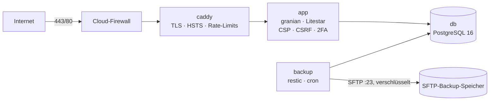

# Betriebs-Runbook – PUSTERUM (www.pusterum.be)

Produktionsbetrieb auf einem Cloud-Server mit Docker Compose. Alle Befehle laufen
als Benutzer `deploy` im Verzeichnis `/opt/pusterum` (Git-Checkout dieses Repositorys).



---

## 1. Erstinstallation

### 1.1 Server & Netzwerk
1. Cloud: Server **Ubuntu 24.04**, Standort Falkenstein/Nürnberg/Helsinki, mind. CX22.
   Beim Erstellen `ops/server/cloud-init.yaml` als *Cloud config* einfügen (eigenen SSH-Public-Key eintragen).
2. **Cloud-Firewall** anlegen und dem Server zuweisen:

   | Richtung | Protokoll | Port | Quelle |
   | :--- | :--- | :--- | :--- |
   | eingehend | TCP | 22 | nur eigene IP(s) |
   | eingehend | TCP | 80, 443 | alle |
   | eingehend | UDP | 443 | alle (HTTP/3) |

3. fail2ban-Konfiguration übernehmen:
   ```bash
   sudo cp ops/fail2ban/filter.d/pusterum-admin.conf /etc/fail2ban/filter.d/
   sudo cp ops/fail2ban/jail.d/pusterum.conf /etc/fail2ban/jail.d/
   sudo systemctl restart fail2ban && sudo fail2ban-client status
   ```

### 1.2 DNS (`pusterum.be`)

| Typ | Name | Wert |
| :--- | :--- | :--- |
| A / AAAA | `@` und `www` | IPv4 / IPv6 des Servers |
| CAA | `@` | `0 issue "letsencrypt.org"` |
| TXT (SPF) | `@` | gemäss Mail-Provider, z. B. `v=spf1 include:<provider> -all` |
| TXT (DKIM) | `<selector>._domainkey` | vom Mail-Provider |
| TXT (DMARC) | `_dmarc` | `v=DMARC1; p=quarantine; rua=mailto:dmarc@pusterum.be` |

### 1.3 Secrets anlegen (nie ins Git!)
```bash
cd /opt/pusterum
cp config/env.production.example .env
cp config/db.env.production.example db.env
cp config/backup.env.production.example backup.env
chmod 600 .env db.env backup.env
python3 -c 'import secrets; print(secrets.token_hex(32))'        # → SECRET_KEY
python3 -c 'import secrets; print(secrets.token_urlsafe(32))'    # → DB-Passwort (in db.env UND DATABASE_URL)
```
Alle `CHANGE_ME` ersetzen. Die App **verweigert den Start**, solange Platzhalter, das Dev-Secret,
`DEBUG=true` oder Mailversand ohne TLS konfiguriert sind.

### 1.4 Backup-Ziel (SFTP-Backup-Speicher)
```bash
mkdir -p secrets/backup_ssh && chmod 700 secrets secrets/backup_ssh
ssh-keygen -t ed25519 -N '' -f secrets/backup_ssh/id_ed25519 -C pusterum-backup
cp ops/backup/ssh-config.example secrets/backup_ssh/config   # Host/User anpassen
# Public Key auf der Storage Box hinterlegen (Port 23):
cat secrets/backup_ssh/id_ed25519.pub | ssh -p 23 uXXXXXX@backup.example.net install-ssh-key
ssh-keyscan -p 23 backup.example.net > secrets/backup_ssh/known_hosts
chmod 600 secrets/backup_ssh/*
```
Das `RESTIC_PASSWORD` zusätzlich **offline** aufbewahren (Passwortmanager + Ausdruck) – ohne es
sind die Backups wertlos.

### 1.5 Start & erster Admin
```bash
docker compose -f docker-compose.prod.yml up -d --build
docker compose -f docker-compose.prod.yml ps          # alle Dienste "healthy"
docker compose -f docker-compose.prod.yml exec app python -m atem.cli create-admin \
    --username stephanie --email kontakt@pusterum.be  # Passwort wird abgefragt (≥ 12 Zeichen)
```
Danach unter `https://www.pusterum.be/admin/login` anmelden – die App verlangt zuerst die
Einrichtung der **Zwei-Faktor-Anmeldung** (Authenticator-App). Die angezeigten
**Wiederherstellungscodes** sicher aufbewahren.

---

## 2. Deployment (Update)
```bash
cd /opt/pusterum
git pull --ff-only
docker compose -f docker-compose.prod.yml up -d --build   # Migrationen laufen automatisch (Entrypoint)
docker compose -f docker-compose.prod.yml ps
curl -fsS https://www.pusterum.be/health/ready
```

### Rollback
```bash
git log --oneline -5
git checkout <vorheriger-commit>
docker compose -f docker-compose.prod.yml up -d --build
```
Datenmigrationen sind additiv (alte Texte bleiben in der Versionshistorie). Für Schema-Rollbacks
vorher ein Backup einspielen (Abschnitt 3.3).

---

## 3. Backups

### 3.1 Automatik
* Täglich **02:30** (Europe/Zurich): `pg_dump` + hochgeladene Medien → restic (verschlüsselt,
  dedupliziert) auf die Storage Box. Aufbewahrung: 7 täglich, 4 wöchentlich, 6 monatlich.
* Sonntags **04:15**: `restic check --read-data-subset=5%`.
* Optional Überwachung via `HEALTHCHECK_PING_URL` (z. B. healthchecks.io: Warnung bei ausbleibendem Backup).

### 3.2 Manuell / Kontrolle
```bash
docker compose -f docker-compose.prod.yml exec backup backup.sh
docker compose -f docker-compose.prod.yml exec backup restic snapshots
```

### 3.3 Wiederherstellung (getestet)
```bash
docker compose -f docker-compose.prod.yml stop app
docker compose -f docker-compose.prod.yml --profile restore run --rm restore restore.sh latest --yes
docker compose -f docker-compose.prod.yml start app
```
Ein bestimmter Stand: `restic snapshots` → ID statt `latest`.
**Restore-Test mindestens halbjährlich** auf einem Testserver durchführen und hier protokollieren.

---

## 4. Notfälle

| Situation | Massnahme |
| :--- | :--- |
| Smartphone (2FA) verloren | Wiederherstellungscode verwenden – oder: `docker compose -f docker-compose.prod.yml exec app python -m atem.cli reset-2fa --username stephanie` |
| Passwort vergessen | Neuen Admin anlegen (`create-admin`), altes Konto bei Bedarf in der DB deaktivieren |
| Verdacht auf kompromittierte Session | Im Admin «Abmelden» (widerruft alle Sessions) bzw. Passwort ändern; notfalls `SECRET_KEY` rotieren (alle Sessions ungültig) |
| IP fälschlich gesperrt | `sudo fail2ban-client set pusterum-admin unbanip <IP>` |
| Zertifikat erneuert sich nicht | `docker compose -f docker-compose.prod.yml logs caddy`, DNS/Port 80 prüfen |
| Kontaktdaten löschen (Auskunfts-/Löschbegehren) | Admin → Dashboard → Nachricht «Löschen»; automatische Löschung nach `MESSAGE_RETENTION_DAYS` |

## 5. Überwachung (empfohlen)
* Uptime-Check auf `https://www.pusterum.be/health/ready` (prüft DB) – Intervall 5 min.
* Zertifikatsablauf (Caddy erneuert automatisch; Warnung < 14 Tage).
* Speicherplatz: `df -h` / Server-Metriken (Logs sind auf 5 × 10 MB pro Container begrenzt).
* `docker compose -f docker-compose.prod.yml logs --since 24h app | grep -E "login_failed|unhandled_exception"`.
