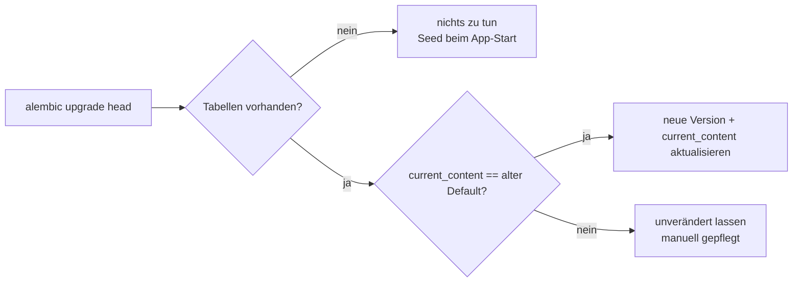

# TDR-0003: Zitat-Band (Quote Rotator) & Datenmigration für Default-Inhalte

* **Status:** accepted
* **Date:** 2026-10-04
* **Author:** Nicolas Mischler
* **Scope:** `components/quotes.html`, `DEFAULT_CONTENT_BLOCKS`, `migrations/versions/`

## Problem / Scope

Im Zuge des Rebrandings «Hā Ola» → **PUSTERUM** kommen zwei technische Fragen auf:

1. Sechs Zitate zum Atem (Nestor, Hof, Tolle, Sivananda, Orr, Cousins) sollen auf der Startseite erscheinen,
   ohne die Seite zu überladen, und weiterhin über das Inline-Editing (ADR-0002) pflegbar bleiben.
2. `_ensure_seed_data` fügt nur **fehlende** Content-Keys ein. Bestehende Datenbanken behalten daher die alten
   Default-Texte, wenn sich `DEFAULT_CONTENT_BLOCKS` ändert.

## Technical Decision

**Zitat-Band:** Neue Komponente `components/quotes.html`, eingebunden nach «Über mich». Jedes Zitat besteht aus
zwei Content-Blöcken (`quotes.N.text`, `quotes.N.author`, Sektion `quotes`). Öffentliche Besucher sehen eine
Alpine.js-Rotation (7 s, Fade, Pause bei Hover/Fokus, Punkt-Navigation, `aria-live="polite"`); bei
`prefers-reduced-motion: reduce` gibt es keine Auto-Rotation. Admins sehen alle Zitate untereinander, damit
jedes Zitat direkt bearbeitet werden kann.

**Datenmigration:** Änderungen an Default-Texten werden als reine Alembic-Datenmigration ausgeliefert
(erste Revision `0001_pusterum_rebranding`). Die Migration enthält einen eingefrorenen Snapshot
`{key: (alter Default, neuer Default, Block-Typ)}` und ersetzt nur Blöcke, deren `current_content` **exakt**
dem alten Default entspricht. Jede Ersetzung wird als neue Version (`author_name="System Migration"`)
geschrieben, sodass der alte Text über die Versionshistorie wiederherstellbar bleibt.

**Leere Content-Blöcke:** Alle Text-Blöcke dürfen leer gespeichert werden; nur Bild-Blöcke bleiben
Pflichtfelder (ein leerer Pfad ergäbe ein defektes Bild). Das `editable()`-Macro rendert leere Blöcke
öffentlich nicht und zeigt Admins einen gestrichelten Platzhalter („Optionales Feld – leer …“), damit das
Feld auffindbar bleibt.
Migrationen `0002`/`0003` haben `hero.text` erst gekürzt und dann geleert.

## Rationale & Trade-offs

* **Why this approach:** Ein rotierendes Band zeigt alle Zitate bei minimalem Platzbedarf; die Pflege bleibt
  im bestehenden Content-System. Die Exakt-Vergleich-Migration aktualisiert Altbestände, ohne manuelle
  Anpassungen der Praxisinhaberin zu überschreiben.
* **Alternatives evaluated:** Zitate im Atem-Pause-Popover (zu versteckt); statische Liste (zu lang).
  Für Bestandsdaten: DB zurücksetzen (Datenverlust) oder Seed-Logik mit Überschreiben (würde manuelle
  Änderungen zerstören).
* **Impact on existing code:** Das Schema wird weiterhin per `create_all` erstellt; Alembic-Revisionen sind
  vorerst reine Datenmigrationen und prüfen die Existenz der Tabellen. Künftige Text-Änderungen an
  `DEFAULT_CONTENT_BLOCKS` sollten nach demselben Muster migriert werden.
