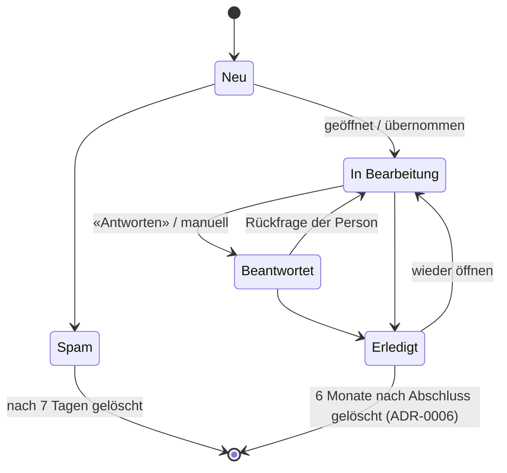

# TDR-0010: Verwaltung der Kontaktanfragen (Status, Liste, Detail)

* **Status:** accepted (umgesetzt 2026-10-18)
* **Date:** 2026-10-16
* **Author:** Betreiber (Technik)
* **Scope:** `domain/models/contact.py` (`MessageStatus`, `RetentionPolicy`, `MessageQuery`), `ContactService`,
  Kontakt-Repository, `controllers/admin/messages.py`, Admin-Templates `messages*.html`/`message_*.html`,
  Migration `0019_contact_status_model`

## Problem / Scope

Bisher gab es vier Status (`NEW`, `READ`, `REPLIED`, `ARCHIVED`) und eine Liste der neuesten 50
Anfragen im Dashboard:

* kein Filter, keine Suche, keine Sortierung, kein Paging;
* die Zähler rechnen nur über diese 50 Zeilen und sind ab der 51. Anfrage falsch;
* das Feld `notes` existiert, ist aber in der Oberfläche nicht sichtbar;
* niemand sieht, welche Anfragen liegen geblieben sind oder wann eine Anfrage gelöscht wird.

Mit einem zweiten Admin-Konto braucht es ausserdem Nachvollziehbarkeit (wer hat was geändert).

## Technical Decision

### Statusmodell

| Status | Bedeutung | Löschfrist (ADR-0006) |
| :--- | :--- | :--- |
| Neu | noch nicht angesehen | spätestens 12 Monate nach Eingang |
| In Bearbeitung | angesehen, Antwort ausstehend | spätestens 12 Monate nach Eingang |
| Beantwortet | Antwort gesendet, Rückmeldung möglich | spätestens 12 Monate nach Eingang |
| Erledigt | abgeschlossen | 6 Monate nach Abschluss |
| Spam | kein echtes Anliegen | 7 Tage |

* Codes in der Datenbank: `NEW`, `IN_PROGRESS`, `REPLIED`, `DONE`, `SPAM`. Sie bleiben stabil;
  angezeigt werden nur die deutschen Namen. Neue Status brauchen eine Migration und einen Eintrag in
  `RetentionPolicy`.
* «Offen» heisst Neu, In Bearbeitung oder Beantwortet.
* Migration: `READ` wird zu `IN_PROGRESS`, `ARCHIVED` zu `DONE` (mit `closed_at` = `updated_at`).
* Beim ersten Öffnen der Detailansicht wechselt «Neu» automatisch zu «In Bearbeitung». «Neu» ist
  kein manuelles Ziel.
* Entscheid Praxis (2026-10-18): **keine Wiedervorlage und keine Zuweisung.**

### Fristen

* `RetentionPolicy`: Erledigt 183 Tage nach `closed_at`, Spam 7 Tage nach `closed_at`, alle anderen
  spätestens 365 Tage nach Eingang. Werte aus `MESSAGE_RETENTION_DONE_DAYS`,
  `MESSAGE_RETENTION_SPAM_DAYS`, `MESSAGE_RETENTION_DAYS`; später im Admin einstellbar.
* `closed_at` wird beim Schliessen (Erledigt, Spam) gesetzt und beim Wiederöffnen gelöscht.
* Der tägliche Lauf löscht Anfragen und Verlauf; Liste und Detail zeigen «wird gelöscht am …».

### Datenmodell

* Neue Spalte `contact_messages.closed_at`.
* Neue Tabelle `contact_message_events`: `message_id` (`ON DELETE CASCADE`), `created_at`, `actor_id`
  (`ON DELETE SET NULL`), `action` (`STATUS`, `NOTES`), `old_value`, `new_value`. Ohne Inhalte der
  Anfrage: Bei Notizen steht nur, dass sie geändert wurden.
* Index (`status`, `created_at`) ersetzt den Index auf `status`.

### Liste (`/admin/messages`)

* Reiter Offen (Standard), je Status und Alle, mit Zählern aus `COUNT ... GROUP BY status`.
* Suche über Name, E-Mail und Betreff (`ILIKE`, Platzhalter maskiert); der Text ist verschlüsselt
  (TDR-0012) und nicht durchsuchbar. Zeitraum von/bis in Schweizer Zeit.
* Sortierung: offene zuerst (Standard), neueste, älteste, Name, Status (Ablauf-Reihenfolge).
* Paging mit 25 Einträgen.
* Hinweise: «überfällig» (mehr als 2 Tage «Neu»), «wird gelöscht am …».
* Umsetzung: normales GET-Formular mit Query-Parametern (`?status=&q=&from=&to=&sort=&page=`).
  Filter sind als Link teilbar, der Zurück-Knopf funktioniert, es braucht kein JavaScript.
  Ungültige Werte fallen auf die Vorgaben zurück.
* Das Dashboard zeigt die 5 neuesten offenen Anfragen und verlinkt auf die Liste.

### Detailansicht (`/admin/messages/{id}`)

* Voller Text, Kontaktdaten (`mailto:`, `tel:`), Notizen mit Knopf «Speichern», Verlauf.
* «Antworten»: `mailto:` mit Betreff «Re: <Betreff>»; daneben «Als beantwortet markieren».
* Aktionen: Status setzen (Formulare, Weiterleitung 303), «Wieder öffnen» bei geschlossenen Anfragen,
  Export aller Anfragen dieser Adresse als JSON (Auskunft, ohne Statuswechsel), «Löschen» mit
  Bestätigungs-Häkchen (auch serverseitig geprüft).
* «Alle Anfragen dieser Person löschen» folgt mit #4 (Löschprotokoll, ADR-0006).

### Benachrichtigung (ADR-0006)

Die Mail an die Praxis enthält nur Vorname, Betreff und den Link auf die Detailansicht
(`PUBLIC_BASE_URL`), kein Reply-To, keinen Text, keine Telefonnummer und keine E-Mail-Adresse.

## Rationale & Trade-offs

* **Why this approach:**
  * Wenige, klar unterscheidbare Status, die zu den Löschfristen passen (ADR-0006).
  * Alles serverseitig mit klassischen Formularen, also testbar mit den bestehenden Unit- und E2E-Tests.
  * Der Verlauf macht Änderungen bei mehreren Admins nachvollziehbar, ohne Personendaten zu
    vervielfachen.
* **Alternatives evaluated:**
  * Client-Tabelle mit JS-Bibliothek: lädt alle Daten in den Browser und bräuchte eine CSP-Ausnahme.
  * Externes Ticketsystem oder CRM: zusätzlicher Auftragsbearbeiter für Gesundheitsdaten.
  * Nur Status ohne Verlauf: bei zwei Konten nicht nachvollziehbar.
  * HTMX-Tabelle mit `hx-push-url`: flüssiger, aber mehr Code; das GET-Formular reicht bei wenigen
    Anfragen pro Woche.
* **Impact on existing code:**
  * Migration `0019` (Status-Codes, `closed_at`, Verlaufstabelle, Index).
  * `IContactRepository`: `search_messages`, `add_event`, `list_events`, `delete_expired` (ersetzt
    `get_messages` und `delete_messages_older_than`).
  * Eigener Controller `AdminMessagesController` (`require_admin`, `tests/test_route_guards.py`); die
    bisherigen HTMX-Routen im Dashboard entfallen.
  * Neue Settings `PUBLIC_BASE_URL`, `MESSAGE_RETENTION_DONE_DAYS`, `MESSAGE_RETENTION_SPAM_DAYS`.
