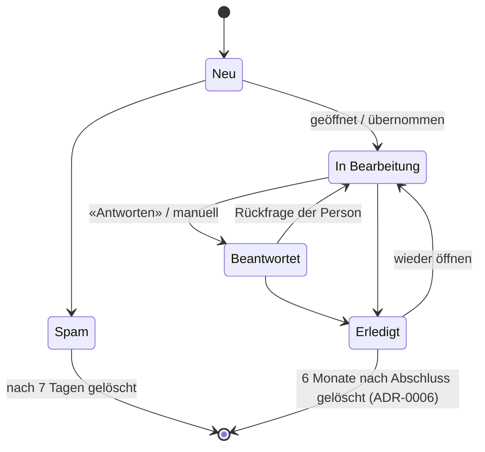

# TDR-0010: Verwaltung der Kontaktanfragen (Status, Liste, Detail)

* **Status:** proposed
* **Date:** 2026-10-16
* **Author:** Betreiber (Technik)
* **Scope:** `domain/models/contact.py`, `ContactService`, Kontakt-Repository, `controllers/admin/dashboard.py`, Admin-Templates, Migration

## Problem / Scope

Heute gibt es vier Status (`NEW`, `READ`, `REPLIED`, `ARCHIVED`) und eine Liste der neuesten 50
Anfragen im Dashboard:

* kein Filter, keine Suche, keine Sortierung, kein Paging;
* die Zähler rechnen nur über diese 50 Zeilen und sind ab der 51. Anfrage falsch;
* das Feld `notes` existiert, ist aber in der Oberfläche nicht sichtbar;
* niemand sieht, welche Anfragen liegen geblieben sind oder wann eine Anfrage gelöscht wird.

Mit einem zweiten Admin-Konto braucht es ausserdem Nachvollziehbarkeit (wer hat was geändert).

## Technical Decision

### Statusmodell

| Status | Bedeutung | Löschfrist (ADR-0006) |
| :--- | :--- | :--- |
| Neu | noch nicht angesehen | spätestens 12 Monate nach Eingang |
| In Bearbeitung | angesehen, Antwort ausstehend | spätestens 12 Monate nach Eingang |
| Beantwortet | Antwort gesendet, Rückmeldung möglich | spätestens 12 Monate nach Eingang |
| Erledigt | abgeschlossen | 6 Monate nach Abschluss |
| Spam | kein echtes Anliegen | 7 Tage |

* Migration: `READ` wird zu «In Bearbeitung», `ARCHIVED` zu «Erledigt» (mit `closed_at` =
  `updated_at`).
* Beim ersten Öffnen der Detailansicht wechselt «Neu» automatisch zu «In Bearbeitung».

### Datenmodell

* Neue Felder in `contact_messages`: `status_changed_at`, `replied_at`, `closed_at`,
  `follow_up_on` (Datum der Wiedervorlage, optional), `assigned_to` (Admin, optional).
* Neue Tabelle `contact_message_events`: `message_id`, `at`, `admin_id`, `action` (Status, Notiz,
  Zuweisung), `old_value`, `new_value`. Ohne Inhalte der Anfrage; sie wird mit der Anfrage gelöscht
  (`ON DELETE CASCADE`).
* Index für die Liste: (`status`, `created_at`).

### Liste

* Status-Reiter mit Zählern aus `COUNT ... GROUP BY status` (behebt den Zähler-Fehler).
* Suche über Name, E-Mail und Betreff (`ILIKE`, serverseitig); Zeitraum von/bis.
* Sortierung nach Eingang, Status, Name; Standard: offene zuerst, dann neueste.
* Paging mit 25 Einträgen.
* Hinweise: «überfällig» (mehr als 2 Tage «Neu»), «Wiedervorlage heute», «wird gelöscht am …».
* Umsetzung: Query-Parameter (`?status=&q=&from=&to=&sort=&page=`), HTMX tauscht nur die Tabelle
  (`hx-get`, `hx-push-url`), damit Filter als Link teilbar sind und der Zurück-Knopf funktioniert.
  Keine neue Browser-Bibliothek; strikte CSP und Alpine-CSP-Build bleiben unverändert.

### Detailansicht

* Voller Text, Kontaktdaten, Notizen (bearbeitbar, Auto-Save), Verlauf aus
  `contact_message_events`.
* «Antworten»: `mailto:` mit Betreff «Re: <Betreff>» an die Absenderadresse; danach Vorschlag
  «Als beantwortet markieren».
* Aktionen: Status setzen, Wiedervorlage, Zuweisen, «Löschen», «Alle Anfragen dieser Person löschen»
  (ADR-0006), «Daten exportieren» (Auskunft).

## Rationale & Trade-offs

* **Why this approach:**
  * Wenige, klar unterscheidbare Status, die zu den Löschfristen passen (ADR-0006).
  * Alles serverseitig mit HTMX, also testbar mit den bestehenden Unit- und E2E-Tests.
  * Der Verlauf macht Änderungen bei mehreren Admins nachvollziehbar, ohne Personendaten zu
    vervielfachen.
* **Alternatives evaluated:**
  * Client-Tabelle mit JS-Bibliothek: lädt alle Daten in den Browser und bräuchte eine CSP-Ausnahme.
  * Externes Ticketsystem oder CRM: zusätzlicher Auftragsbearbeiter für Gesundheitsdaten.
  * Nur Status ohne Verlauf: bei zwei Konten nicht nachvollziehbar.
* **Impact on existing code:**
  * Alembic-Migration (Enum-Werte, neue Spalten, neue Tabelle).
  * `IContactRepository` bekommt Filter-, Zähl- und Suchmethoden.
  * Neue Admin-Routen kommen in den bestehenden geschützten Controller (`require_admin`,
    `tests/test_route_guards.py`).
